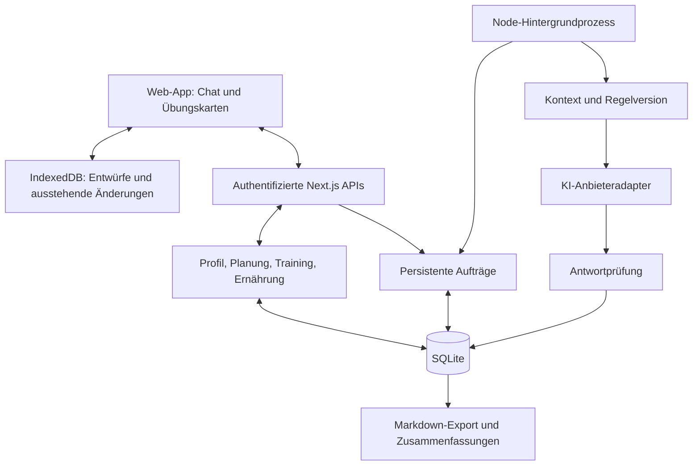

# Architekturentwurf

Stand: 17.10.2026. Geplanter Zustand; Implementierungsaufgaben stehen in der [Roadmap](ROADMAP.md).

## Bestehende Grundlage

Next.js/React, TypeScript, Tailwind, Zod, Drizzle und better-sqlite3 bleiben erhalten. Wiederverwenden: Plan- und Übungsverwaltung, Workout-Snapshots, Satzversionen und Mutations-IDs, Timer, Ernährung, Beratung, Login und vorhandener ChatGPT-Transport.

Aktuell: persönliche Instanz, SQLite mit WAL, lokale Satzwarteschlange über localStorage, keine vollständige Offline-App. Direkte ChatGPT-Anmeldung ist im Code auf lokale Loopback-Adressen beschränkt. Diese Einschränkungen sind nicht durch das neue Konzept bereits behoben.

## Komponenten



Der Chat rendert feste Kartentypen wie Planübersicht, aktive Übung, Satzergebnisse und Mahlzeitenentwurf. Modelltext erzeugt kein ausführbares HTML oder beliebige UI-Komponenten. Karten verweisen auf Fachobjekte und deren Version; Zahlen werden nicht aus gerendertem Markdown zurückgelesen.

## Fachlicher Zustand und Datenmodell

Eine serverseitige SQLite-Datenbank reicht zunächst. Bestehende Tabellen additiv erweitern; Namen im folgenden Entwurf sind Vorschläge, keine Migrationen.

| Bereich | Neue/erweiterte Datensätze und Beziehungen |
| --- | --- |
| Profil | Profilversion, Ziele, Erfahrung, Equipment, Zeitbudget/Häufigkeit, Spaßfaktoren, Vorlieben/Abneigungen, Motivation, Zeitzone, freiwillige Angaben; je Angabe Quelle und Bestätigungsstatus |
| Onboarding | Schritt, Gespräch, offene Fragen, vorläufige Angaben, bestätigte Profilversion |
| Planung | Trainingsblock mit Start/Ende; unveränderliche Planversionen; Wochentagszuordnung; Regelversion; Begründung mit Profilbezug; optionale erklärende Stileinordnung; individuelle Ausnahmen |
| Training | Verbindung zu Block/Planversion; Datum; Status; aktuelle Übung; vorhandene Übungs-/Satz-Snapshots; Trennung Aufwärmung/Arbeit/Deload |
| Gespräche | Threadtyp und Fachobjekt-ID; Nachrichten mit Rolle, Reihenfolge, Status, öffentlichem Text; Kartenreferenzen; eindeutige Client-Nachrichten-ID |
| Gedächtnis | Bestätigte Vorlieben und Zusammenfassungen mit Quellen-IDs/-Versionen, Gültigkeit und Änderungszeit |
| Aufträge | Typ, Status, Eingabeversionen, Ergebnis, Versuche, Bearbeitungsfrist/Lease, Abbruch-/Fehlergrund |
| Medien | Typ, Besitzer, Speicherverweis, Quelle/Lizenz bei Übungshilfen, Übertragungsentscheidung, Löschstatus |
| Änderungen | Versions- und Mutationsinformationen für Konflikte, Deduplizierung und nachvollziehbare Korrekturen |

Ein blockbezogener Fortschritt unterscheidet geplante, absolvierte, verschobene und ausgelassene Einheiten. Lokales Trainingsdatum und Zeitzone zusätzlich zu UTC-Zeitstempeln speichern. Tatsächliche Planparameter, Regelversionen und Aufwärm-/Deloadstatus gehören in die Vergleichsgrundlage für Progression; ein Stilname ist dafür kein Kriterium.

Zeitliche Grenzen, ausdrücklich geäußerte Vorlieben und vorläufig abgeleitete Interpretationen getrennt speichern. Unbekannte Vorlieben bleiben unbekannt. Die Begründung einer Planentscheidung verweist auf ihre Nutzerangaben; eine Modellanalogie zu einer Philosophie wird nicht zurück als bestätigte Präferenz ins Profil geschrieben. Kein verpflichtendes Stil-Enum und keine Beschränkung auf feste Personen-Presets. Spätere Rückmeldungen versioniert aufnehmen; laufende Einheiten und historische Pläne dabei erhalten.

Zustände einer Einheit: bereit → aktiv ↔ pausiert → abgeschlossen; abgebrochen separat. Wiederöffnen einer abgeschlossenen Einheit als ausdrückliche Korrektur behandeln. Planänderungen schreiben keine früheren Snapshots um. Kein Zustand wird allein aus einer KI-Formulierung wie „Training erledigt“ abgeleitet.

## Synchronisierung und Abstürze

1. Eingabe als Entwurf in IndexedDB sichern; ungültige Zwischenstände dürfen lokal bleiben.
2. Gültige Änderungen mit Fachobjekt-ID, Ausgangsversion und stabiler Mutations-ID übertragen. Kritische Aktionen unmittelbar, normale Eingaben kurz gebündelt.
3. Server prüft Zugriff, Version und Werte und schreibt atomar. Erst die Bestätigung erlaubt „Gespeichert“.
4. Nach fehlender Antwort dieselbe Mutation erneut senden. Serverseitige Deduplizierung verhindert doppelte Sätze/Nachrichten. Bei veralteter Version einen Konflikt liefern, nicht still überschreiben.
5. Neu öffnen: Serverstand und lokale Warteschlange abgleichen; bestätigte Einträge entfernen, Konflikte sichtbar machen. Auch mehrere Browserfenster berücksichtigen.
6. Übungsabschluss nutzt synchronisierte Satzversionen und erzeugt einmalig den zugehörigen Chatbeitrag. Trainingsabschluss erst nach bestätigtem Datenstand; offline allenfalls als ausstehend anzeigen.

IndexedDB ergänzt die Serverdaten, ersetzt sie nicht. Browserdaten können gelöscht werden, Speicherzugriffe können scheitern. Dann darf die Oberfläche keine lokale Sicherung behaupten. Bestehende localStorage-Warteschlange verlustfrei übernehmen, bevor sie entfernt wird. Das Löschen des Browserdatenspeichers kann noch nicht synchronisierte Änderungen unwiederbringlich entfernen.

Service Worker: Anwendungshülle und bewusst begrenzte aktive Trainingsdaten offline verfügbar machen. Keine pauschale Zwischenspeicherung authentifizierter API-Antworten, Tokens oder ganzer Tagebücher. Konten-/Logoutwechsel müssen lokale private Daten und Caches behandeln; ausstehende Änderungen vorher sichtbar machen. Keine Garantie für Hintergrundsynchronisierung bei geschlossenem Safari. Speicherung beim Schließen allein ist ungeeignet. [MDN: IndexedDB und Browserende](https://developer.mozilla.org/en-US/docs/Web/API/IndexedDB_API/Using_IndexedDB)

## Eigene APIs

Alle Routen sind Entwürfe, außer der bereits vorhandenen Satzroute. Mutationen bleiben authentifizierte, größenbegrenzte POST/PATCH/DELETE-Aufrufe mit Origin-Prüfung; keine Zustandsänderungen über GET.

| Schnittstelle | Vertrag |
| --- | --- |
| `POST /api/conversations/:id/messages` | Nachricht einmalig speichern, Auftrag anlegen, IDs/Status zurückgeben |
| `GET /api/conversations/:id` | Persistierte Nachrichten und Kartenreferenzen laden, bei Bedarf seitenweise |
| `GET /api/conversations/:id/events` | Ereignisstream mit Cursor; Wiederverbindung lädt gespeicherte Ergebnisse nach |
| `PATCH /api/workouts/:id/sets/:setId` | Vorhandene Satzspeicherung weiterverwenden |
| `POST /api/workouts/:id/actions` | Start/Pause/Fortsetzen/Übungsabschluss mit Versionsprüfung; vorhandene Routen nicht abrupt brechen |
| `PATCH /api/profile` | Bestätigte Profiländerung mit Version |
| `POST /api/training-blocks` | Validierten, freigegebenen Plan als Block speichern |
| `POST /api/media` | Später begrenzte Uploads; geschützte Ausgabe und Löschung separat |
| `GET /api/jobs/:id` | Status und Wiederaufnahme bei unterbrochenem Stream |

Aufträge und Nachrichten atomar anlegen. Ein Node-Hintergrundprozess übernimmt persistierte Aufträge über eine Lease; keine flüchtige Fire-and-forget-Promise nach einer HTTP-Antwort. Für den persönlichen Betrieb keine zusätzliche Redis-Infrastruktur nötig. API und Worker greifen auf dieselbe SQLite-Datei zu; kurze Transaktionen, keine Datenbanksperre während eines Modellaufrufs.

Der Browser kann verschwinden, ohne den Auftrag zu verlieren. Unvollständige Antworten als solche speichern. Nach Worker-Absturz ist die tatsächliche Durchführung einer Modellanfrage gegebenenfalls unbekannt: nicht unbegrenzt automatisch neu anfragen. Lokale Mutationen sind deduplizierbar; eine exakt einmalige externe Inferenz wird nicht versprochen. Verspätete Vorschläge nur übernehmen, wenn ihre Ausgangsversionen noch passen.

## KI-Anbieter und Kostenvorgabe

Eine interne Schnittstelle trennt Fachlogik und Transport. Sie liefert Anbieterkennung, verfügbare Modelle, Fähigkeiten (Text/Bild/strukturierte Antwort/Streaming), Berechtigungsstatus, Abrechnungsart und normierte Fehler. Fachaufträge wie `plan.create`, `workout.interpret`, `advice.reply` und `summary.create` hängen nicht von einem Modellnamen ab.

Erster Adapter: vorhandene offizielle ChatGPT-Anbindung. Zweiter vorhandener Weg: manuelles Kopieren/Importieren, ausdrücklich als manueller Vorgang. Weitere Adapter später, beispielsweise ein lokal betriebenes Modell. Kein Anbieterwechsel oder Versand an einen anderen Dienst ohne bewusste Auswahl. Gleiche Validierung für alle Adapter; neue Anbieter müssen die Vertrags- und Wiederaufnahmetests erfüllen.

Kein API-Key-Fallback, keine automatische Guthabenaufladung. Ein normaler ChatGPT-Login garantiert keinen nutzbaren Inferenzzugang: Die aktuelle Dokumentation beschreibt geeignete Plus-/Pro-Konten. Konto, Modell und Freigabe werden tatsächlich geprüft; Free-Zugang wird nicht zugesichert. [OpenAI Quickstart](https://developers.openai.com/siwc/quickstart)

Anbieterseitige Einstellungen können Abo-Nutzung und Credits beeinflussen. Die App darf „keinerlei Zusatzkosten garantiert“ nur behaupten, wenn der ausgewählte Weg dies verlässlich erzwingt. Vor Freigabe prüfen, wie bezahlte Mehrnutzung ausgeschlossen wird; anderenfalls die Einschränkung klar machen und diesen direkten Weg nicht als strikt kostenfrei freigeben. [OpenAI: Konten und Nutzungseinstellungen](https://developers.openai.com/siwc/token-sharing-open-source/profiles-and-sessions)

Das heutige interne App-Budget von fünf direkten Anfragen pro 15 Minuten und 30 pro Tag ist kein Plus-Kontingent. Für Chatabläufe bewusst neu bewerten, anbieterbedingte Limits respektieren. Tabellenbearbeitung und normale Trainingsfortsetzung benötigen keine Inferenz; KI pro abgeschlossener Übung optional bündeln. Zusammenfassungen können warten und zunächst aus Fakten deterministisch erzeugt werden.

Die ChatGPT-Anbindung verwendet derzeit `POST https://api.openai.com/v1/responses`, OAuth und strukturierte Antworten; dies ist technisch eine API, aber kein API-Key-Abrechnungsweg. Kontext und Gesprächsdaten selbst verwalten (`store: false`, `stream: true`). Text/Bilder hängen von Modellfähigkeiten ab; Transkriptions-API und Audioeingaben sind in diesem Weg nicht verfügbar. [OpenAI: Einschränkungen](https://developers.openai.com/siwc/token-sharing-open-source/preview-limitations)

## Kontext, Regeln und Gedächtnis

Anfrage besteht aus kurzem festen Auftrag, versionierten Trainingsregeln, aktueller Aufgabe, relevanten Daten und einem Antwortschema. Plan, Ist-Daten und frühere KI-Vorschläge getrennt kennzeichnen. Nutzerdaten und Markdown-Inhalte sind Daten, keine neuen Systemanweisungen. Keine frei ausführbaren Modellbefehle, kein beliebiger SQL-/Dateizugriff.

Kontextauswahl zuerst nach Datum, Fachobjekt, Übung und bestätigten Präferenzen. Keine zusätzliche Vektordatenbank für den ersten Ausbau. Enthaltene IDs/Versionen speichern, damit eine Empfehlung nachvollziehbar bleibt. Fehlende Angaben unbekannt lassen; alte Zusammenfassungen nach Korrekturen invalidieren. Gedächtnis für Nutzer einsehbar und korrigierbar machen.

Öffentlichen Antworttext bei Schemafehlern weiterhin einsehbar halten; keine internen Denktexte oder Geheimnisse speichern. Teilantworten dürfen keine halb geschriebenen Trainingsaktionen auslösen.

## Markdown, Medien und Betrieb

Vorgeschlagene Ablage auf privatem persistentem Speicher:

```text
/data/fittrack.db                      # bestehenden Namen zunächst behalten
/data/journal/2026/10/<workout-id>.md   # Verlauf und Fakten
/data/summaries/workouts/<id>.md       # abgeleitete Zusammenfassung
/data/summaries/weeks/2026-W42.md
/data/profile/preferences.md          # Export bestätigter Angaben
/data/media/<attachment-id>.<ext>      # geschützte Anhänge
```

Kein Repository- oder `public`-Verzeichnis für private Inhalte. Markdown wird aus DB-Daten abgeleitet, nicht parallel als zweite editierbare Wahrheit geführt. Exportkopf enthält Quellen-IDs, Versionen und Erstellungszeit. Atomar schreiben; Exportjobs bei Fehlern erneut ausführbar. Korrekturen/Löschungen erzeugen Aktualisierungs-/Löschaufträge in derselben DB-Transaktion. Nach DB-Wiederherstellung Exporte neu abgleichen, damit keine jüngeren Dateien alte Daten vortäuschen.

Ein Railway-Service mit persistentem Volume und ohne horizontale Replikation als anfängliches Betriebsziel. Worker im selben Deployment mit gemeinsamem Volume beaufsichtigen. HTTPS, Authentifizierung, konsistente SQLite-Backups sowie Wiederherstellungsprobe gehören dazu; Replikation/PostgreSQL erst bei anderem Betriebsbedarf. [Railway Volumes](https://docs.railway.com/volumes)

Die heutige localhost-Sperre nicht einfach entfernen. Die offiziellen OpenAI Docs beschreiben einen Weg für selbst betriebene VMs mit eigener Host-ID, lokaler Anmeldung und geschütztem Credential-Transfer. Ob dies für unseren konkreten Railway-Betrieb und die App-Kategorie passt, ist eine frühe offene Prüfung. Öffentlicher Mehrbenutzerbetrieb ist damit nicht automatisch abgedeckt. [OpenAI: Self-hosted VMs](https://developers.openai.com/siwc/token-sharing-open-source/self-hosted-vms)

Provider-Tokens bleiben ausschließlich geschützt auf dem Server, weder in IndexedDB noch Markdown, Logs oder Service-Worker-Caches. Bereits vorhandene Authentifizierung und sichere POST-Anmeldung beibehalten.
